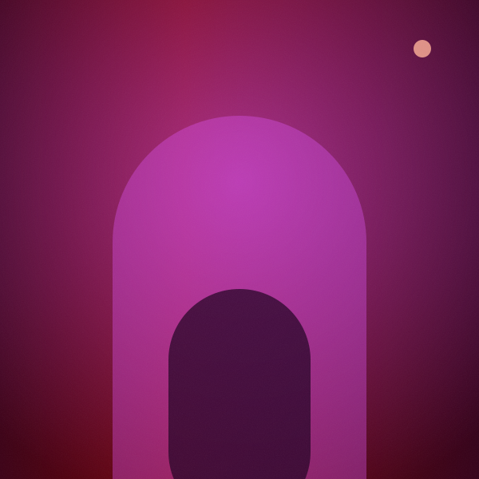

# Spotify Web Player — Clone

A faithful front-end recreation of the Spotify web player, built with **vanilla HTML, CSS and
JavaScript**. No frameworks, no build step, no dependencies — open `index.html` and it runs.

**Live demo → https://77ebz2t2wokan.space.mcode.io**

Every album cover, avatar and playlist tile in this project is generated procedurally by
`tools/gen_covers.py` — 16 palettes × 8 shape grammars, 76 SVGs, zero scraped assets:

<p align="center">
  
  
  
  
  
  
</p>

<p align="center">
  
  
  
  
</p>

---

## Run it

```bash
# any static server works
python3 -m http.server 8000
# → http://localhost:8000
```

Opening `index.html` directly via `file://` also works, except that the Web Audio engine
requires a user gesture before it can start (which a click on Play satisfies).

---

## What's implemented

**Layout**
- Three-panel shell — collapsible library rail, main content, Friend Activity panel — over a
  black page with rounded panels, matching the current Spotify web layout.
- The hero gradient runs *behind* the overlay top bar, so scrolling feels continuous.
- Collapsible sidebar that expands on hover in place (via `:has()`) rather than overlaying
  the content.

**Views**
| Route | View |
|---|---|
| `#/home` | Greeting hero, Jump Back In (persisted), + 7 sections (Top Mixes, Recently Played, Made For You, Jump Back In, New Releases, Popular Artists, Listening History) |
| `#/search` | Live search across songs / artists / playlists, top-result card, recent-search history, 25 genre tiles |
| `#/library` | Saved playlists grid (built-in + the ones you create) |
| `#/playlist/:id` | Playlist header, filter bar, track table, Recommended shelf |
| `#/album/:id` | Album header, track list, credits block, "More from this artist" |
| `#/artist/:id` | Artist header, avatar, Popular, Fans also like, About, Follow toggle |
| `#/genre/:name` | Genre page — artists, releases and every track in the genre |
| `#/liked` | Liked Songs |

**Player**
- Play / pause / next / prev, shuffle, repeat (off → all → one).
- Draggable + keyboard-accessible progress bar and volume slider.
- Queue with "add to queue", liked-songs toggle, per-row now-playing indicator with animated
  equaliser bars.
- **Full-screen Now Playing view** — the signature moment: blurred cover backdrop, large
  artwork, live spectrum analyser, and synced Lyrics / About / Up next panels.
- A generative Web Audio pad means pressing play is actually *audible*; the spectrum bars are
  driven by a real `AnalyserNode`.

**Details**
- Browser back / forward history through app routes.
- Toasts for every state change (saved, shuffled, repeated, queued…), with an inline
  **Undo** on the destructive ones.
- Sticky top bar that reveals the current context once you scroll.
- Responsive: desktop → tablet (Friend Activity folds away) → mobile (bottom tab bar, drawer
  navigation, compact player).
- Keyboard shortcuts, visible focus rings, `prefers-reduced-motion` support, ARIA labels on
  icon-only controls.

---

## Overlays & power features

| Surface | How |
|---|---|
| **Context menu** | Right-click any track row, card, or sidebar playlist — Add to queue, Add to playlist, Go to album / artist, Follow, Remove. |
| **Queue panel** | Slides in from the right. *Now playing* + *Next up*, with per-track remove. |
| **Command palette** | `Ctrl/⌘ K` — jump to any route, playlist, artist, song or genre, or run an action. |
| **Create playlist** | Real modal. The playlist lands in your sidebar and library, is playable, and survives reload. |
| **Add to playlist** | Modal picker over your playlists and the built-in catalogue, or create one on the fly. |
| **Device picker** | Popover above the player — pick a device to "play on". |
| **Keyboard shortcuts** | Press `?` for the full cheat sheet. |
| **Media Session** | OS media keys, lock-screen artwork and hardware seek all work via `navigator.mediaSession`. |
| **Recents** | Recent searches (removable) and *Jump back in* on the home page, both persisted. |
| **Drag to dismiss** | Drag the Now Playing header downward to close it. |

Everything the user creates or changes — liked songs, follows, playlists, volume, view mode,
recent searches, device — persists in `localStorage` and survives a reload.

### Keyboard map

| Key | Action |
|---|---|
| `Space` | Play / pause |
| `Alt` + `←` / `→` | Previous / next track |
| `Shift` + `←` / `→` | Seek ∓15s |
| `/` | Focus search |
| `Ctrl/⌘ K` | Command palette |
| `Q` | Toggle queue |
| `D` | Devices |
| `?` | Shortcuts sheet |
| `Esc` | Close the topmost layer |

---

## Keyboard shortcuts

| Key | Action |
|---|---|
| `Space` | Play / pause |
| `Alt` + `→` | Next track |
| `Alt` + `←` | Previous track |
| `/` | Focus search |
| `Esc` | Close the Now Playing view |

---

## Project layout

```
spotify-clone/
├── index.html            # app shell + inline SVG icon sprite
├── css/styles.css        # design tokens, layout, components, responsive rules
├── js/data.js            # content model: releases, artists, playlists, friends
├── js/app.js             # routing, rendering, playback engine, now-playing view
├── assets/
│   ├── covers/           # 30 album covers + 20 playlist covers (procedural SVG)
│   ├── avatars/          # 25 artist avatars (procedural SVG)
│   └── favicon.svg
└── tools/
    ├── gen_covers.py     # regenerates all artwork (Python, stdlib only)
    ├── shoot.py          # Playwright screenshot pass
    ├── test_app.py       # 29-assertion functional test suite
    └── test_features.py  # 63-assertion feature test suite
```

### Regenerating the artwork

```bash
python3 tools/gen_covers.py
```

Every cover and avatar is composed from deterministic gradients and geometric primitives
seeded by the release title — 16 curated palettes × 8 shape grammars. The script validates
every emitted SVG as well-formed XML before exiting.

---

## Notes on content

All artists, release titles, playlists, lyrics and artwork in this project are **original to
this repository**. Nothing is scraped from, or copied out of, Spotify's catalogue, and no
third-party logos or album images are used. The Spotify name and green accent are used purely
to identify the design being cloned.

---

## Testing

```bash
python3 -m http.server 8765 &      # in the project root
python3 tools/test_app.py          # 29 functional assertions
python3 tools/test_features.py     # 63 feature assertions (overlays, playlists, persistence)
python3 tools/test_layout.py       # layout sweep: 18 widths x 2 sidebar states
python3 tools/test_motion.py       # 17 motion assertions + slow-motion filmstrips
python3 tools/shoot.py             # refresh preview screenshots
```

`test_layout.py` is the guard against responsive regressions: it asserts that no width leaks a
dead column where the hidden friend panel used to sit, that nothing spills past the viewport, and
that the player bar never falls below the fold.

Both require Playwright with Chromium installed (`playwright install chromium`).

---

## Motion system

The animations are not guesses. Spotify's production stylesheet
(`web-player.b71d1029.css`) ships their internal design system, **Encore**. The
values below were extracted directly from it, and the tokens keep their upstream
names so the mapping stays auditable.

| Encore token | Value | Used for |
|---|---|---|
| `--encore-shortest-1` | `50ms` | hover-in response |
| `--encore-shortest-2` | `100ms` | micro feedback |
| `--encore-shortest-3` | `150ms` | default control transition |
| `--encore-shortest-4` | `200ms` | exit transitions |
| `--encore-short-1` | `250ms` | enter transitions |
| `--encore-short-2` | `300ms` | progress fill, nav indicator |
| `--encore-productive` | `cubic-bezier(.3, 0, 0, 1)` | the workhorse curve |
| `--encore-productive-decelerate` | `cubic-bezier(0, 0, .2, 1)` | entering |
| `--encore-productive-accelerate` | `cubic-bezier(.8, 0, 1, 1)` | leaving |

### The trick worth stealing

Spotify's buttons transition at **150ms by default but drop to 50ms while
hovered**. The hover-in is therefore near-instant while the hover-out eases
back over 150ms — responsive on the way in, smooth on the way out. Every
button in this clone implements it:

```css
.pill {
  transition-duration: var(--encore-shortest-3);   /* 150ms */
  transition-timing-function: var(--encore-productive);
}
.pill:hover { transition-duration: var(--encore-shortest-1); }  /* 50ms */
```

### What animates

| Interaction | Motion |
|---|---|
| Route change | exit 200ms accelerate → enter 420ms decelerate, fade + `translateY(16px)` |
| Section entrance | staggered cascade, 45ms apart, fade + `translateY(12px)` |
| Card hover | surface → `#2a2a2a` (150ms), artwork lifts `scale(1.04)`, 48px play button fades + scales in |
| Card artwork load | 250ms `ease-out` fade, over a shimmer placeholder |
| Track row hover | index number is replaced by a play glyph, row tints to `#ffffff1a` |
| Now Playing open | **FLIP** — artwork flies from the player-bar thumbnail into the stage |
| Now Playing close | artwork flies back down, radius morphs 10px → 4px |
| Lyrics | active line highlights and scales up; the panel auto-scrolls to follow the playhead |
| Full-screen backdrop | 28s ambient drift on the blurred cover |
| Progress / volume | fill animates `width` over 300ms; knob scales in on hover |
| Playing track | equaliser bars with per-bar durations; the card button flips to a pause glyph with a pulsing ring |
| Icon buttons | 125ms tooltips, `scale(1.1)` + `#ffffff1a` on hover |
| Toasts | 250ms enter, 200ms exit |

Every one of these is skipped under `prefers-reduced-motion: reduce`.

---

## Deploying

The build is a fully static site — no build step, no server, no environment variables.
`index.html` sits at the root and every asset reference is relative, so it can be hosted
anywhere that serves static files.

### GitHub

The source lives at **https://github.com/saivenkat280506/spotify-web-player-clone**.

```bash
git remote add origin https://github.com/saivenkat280506/spotify-web-player-clone.git
git push -u origin main
```

### Vercel

**Via the dashboard (recommended)** — import
[`saivenkat280506/spotify-web-player-clone`](https://github.com/saivenkat280506/spotify-web-player-clone)
at [vercel.com/new](https://vercel.com/new). Leave *Framework Preset* as **Other** and the build
command empty; Vercel serves the static files as-is. Every subsequent push to `main` redeploys
automatically.

**Via the CLI**

```bash
npm i -g vercel
vercel --prod --token "$VERCEL_TOKEN"
```

`vercel.json` sets long-lived cache headers for `/assets/*`, no-cache for CSS/JS, and baseline
security headers. Routing uses URL hashes, so no SPA rewrite rule is needed.

### Other hosts

`netlify.toml`-style static hosting, GitHub Pages, Cloudflare Pages, S3 + CloudFront, or any
web server will work unchanged — just publish the repository root.

